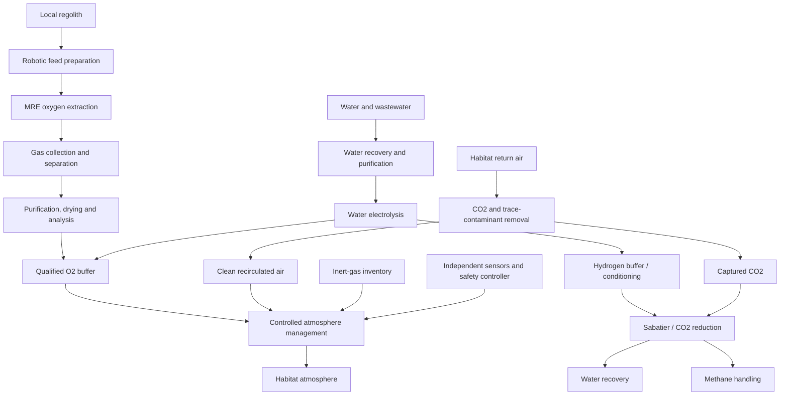

# A-01 AIR-01 — Autonomous Atmospheric Infrastructure

**Engineering concept brief v0.1 · 19 November 2026**  
**Parent programme:** A-01 LUNA / Regolith-Sheltered Modular Habitat  
**Status:** early research concept. Not a flight-qualified ECLSS, NASA design or endorsement, certified pressure system, safety case, or competition submission.

**Languages:** [English](README.md) · [Русский](README_RU.md) · [简体中文](README_ZH.md)

---

## 1. Mission and design intent

AIR-01 is the atmosphere and life-support subsystem proposed for A-01 LUNA. Its goal is not merely to make oxygen. It must help maintain a controlled, breathable habitat environment by coordinating:

1. oxygen production and storage;
2. cabin-air circulation and revitalization;
3. carbon-dioxide capture and controlled processing;
4. water recovery, purification, and electrolysis;
5. inert-gas inventory and atmosphere composition control;
6. pressure, temperature, humidity, fire, and contaminant monitoring;
7. local autonomous control, fault isolation, and crew-safe fallback modes.

The design separates **industrial resource processing** from **clean habitat life support**. Raw gas from a regolith reactor must never flow directly into the occupied volume. It must be collected, conditioned, analysed, accepted by independent checks, and only then transferred into a controlled oxygen buffer.

AIR-01 is intended to reduce routine dependence on Earth resupply over time. It does not assume that the Moon contains every required resource in a usable form or that the system can operate without initial delivered inventory, spare parts, maintenance, and emergency stores.

## 2. Recommended architecture

### 2.1 Two physically separated zones

**Zone A — external resource factory**
- robotic regolith collection, screening, and feed handling;
- a high-temperature oxygen-extraction process, with molten regolith electrolysis (MRE) as the leading study candidate;
- gas collection, separation, purification, drying, and product analysis;
- handling and storage of metal-bearing by-products;
- dust isolation, thermal protection, maintenance access, and industrial power.

**Zone B — clean life-support plant**
- water processing and potable-water quality monitoring;
- water electrolysis and oxygen conditioning;
- oxygen and inert-gas buffers, regulators, and mixing interfaces;
- cabin-air circulation, humidity control, trace-contaminant removal, and CO₂ capture;
- a CO₂ reduction unit such as a Sabatier reactor, if its hydrogen and by-product streams can be safely managed;
- independent sensors, local control, backup power, and crew-accessible service points.

A double-boundary transfer interface separates the two zones. It prevents dust, hot process gases, metal vapours, and unverified products from entering the occupied habitat.

### 2.2 System flow

This is a functional block diagram, not a piping and instrumentation diagram (P&ID). Valve locations, line sizes, operating pressures, relief devices, materials, and interlocks require detailed engineering.

## 3. Oxygen supply strategy

AIR-01 should study two complementary oxygen routes rather than rely on one process.

### 3.1 Primary lunar-resource candidate: molten regolith electrolysis

MRE passes electric current through molten regolith. Metal oxides in the feed are reduced, yielding oxygen gas and a metal-alloy product stream. It is attractive because it may provide both life-support oxygen and useful material by-products.

NASA's NTRS record for a late-2024 large-scale demonstration reports:
- 25 kg of lunar-regolith simulant processed;
- an average oxygen-production rate of 0.07 kg/h;
- nine hours of sustained electrochemical processing;
- operation under vacuum-relevant test conditions.

This is a meaningful ground demonstration, not a demonstrated 24-hour production rating, lunar deployment, certified oxygen purity, or proof of autonomous long-duration operation. AIR-01 must include gas purification and verification between the reactor and the habitat. [NASA NTRS 20260003760](https://ntrs.nasa.gov/citations/20260003760)

NASA has also modelled a larger MRE plant from excavation and preheating through the reactor, oxygen purification, and product storage. The public record describes mass, volume, and power modelling at several annual production targets, but the abstract does not provide a validated AIR-01 power value. This brief therefore leaves MRE electrical and thermal loads open rather than inventing a kW figure. [NASA NTRS 20240013999](https://ntrs.nasa.gov/citations/20240013999)

### 3.2 Supporting route: water electrolysis

Water electrolysis is already used in the International Space Station's Oxygen Generation Assembly. It requires clean feed water and produces oxygen and hydrogen:

[
2H_2O 
ightarrow 2H_2 + O_2
]

NASA's ISS ECLSS description documents the integration of water recovery, air revitalization, oxygen generation, and a Sabatier CO₂-reduction assembly. The ISS water-recovery system is reported to recover and recycle about 90% of station water; this is an in-orbit benchmark, not a guaranteed lunar performance figure. [NASA ECLSS](https://www.nasa.gov/reference/environmental-control-and-life-support-systems-eclss/)

For A-01 LUNA, water may initially be delivered and recycled. Extracted lunar ice is a possible future feedstock only after a site-specific resource survey, mining demonstration, purification process, and water-quality verification.

### 3.3 No raw oxygen goes directly to the cabin

The external production train must measure and control, at minimum:
- oxygen concentration and flow;
- water vapour and condensable content;
- particulate and process-derived contaminants;
- pressure and temperature;
- any other species identified by process chemistry and materials testing.

Out-of-spec gas is isolated from the habitat supply path. It is held for reprocessing, investigation, or disposal through an approved system. The occupied atmosphere receives oxygen only through a separately controlled and monitored interface.

## 4. Preliminary crew mass balance

This section is an arithmetic planning case, not a crew medical specification or a final system-sizing basis.

### 4.1 Reference case

A NASA life-support study reports planning values of approximately 0.84 kg O₂ per crewmember-day and approximately 1.0 kg CO₂ per crewmember-day. AIR-01 uses these values to build an initial four-person reference case. Actual loads vary with activity, crew physiology, mission profile, exercise, EVA operations, and habitat design. [NASA NTRS 20190027610](https://ntrs.nasa.gov/citations/20190027610)

| Quantity | Per person per day | Four-person reference |
|---|---:|---:|
| Oxygen demand | 0.84 kg | **3.36 kg/day** |
| CO₂ generation | 1.00 kg | **4.00 kg/day** |
| O₂ demand over 30 days | 25.2 kg | **100.8 kg** |
| O₂ demand over 365 days | 306.6 kg | **1,226.4 kg** |
| CO₂ generation over 365 days | 365 kg | **1,460 kg** |

These values exclude EVA oxygen, leakage, airlock losses, emergency use, tank residuals, process losses, maintenance downtime, and any mission-specific reserve margin.

### 4.2 Water-electrolysis stoichiometry

For every 1 kg of oxygen produced by ideal water electrolysis:
- water feed is 1.125 kg;
- hydrogen by-product is 0.125 kg.

For the four-person reference case:

| Ideal flow | Derived amount |
|---|---:|
| O₂ production | 3.36 kg/day |
| Water entering electrolysis | **3.78 kg/day** |
| Hydrogen produced | **0.42 kg/day** |

This is a chemical mass balance only. Real systems need water purification, gas drying, separation, leakage allowance, purge flows, and equipment-performance margins.

### 4.3 What the Sabatier loop can and cannot close

The ideal Sabatier reaction is:

[
CO_2 + 4H_2 
ightarrow CH_4 + 2H_2O
]

If all 0.42 kg/day of hydrogen from the reference water-electrolysis flow were fed to an ideal Sabatier reactor, the stoichiometric upper bound would be:

| Sabatier stream | Ideal amount |
|---|---:|
| CO₂ processed | 2.31 kg/day |
| Water returned | 1.89 kg/day |
| Methane produced | 0.84 kg/day |
| CO₂ remaining from 4.00 kg/day metabolic generation | **1.69 kg/day** |

This exposes an important limitation: hydrogen produced by oxygen-generation electrolysis alone is not enough to reduce all of the reference crew's CO₂ through the Sabatier reaction. A-01 must not describe this arrangement as a fully closed oxygen or carbon loop.

The design must compare additional CO₂-reduction pathways, controlled storage/rejection, possible methane processing, and the mass, power, heat, safety, and maintenance cost of each. NASA describes Sabatier operation on the ISS and the methane/water products; the current ISS arrangement releases methane rather than treating it as a fully closed resource loop. [NASA ECLSS](https://www.nasa.gov/reference/environmental-control-and-life-support-systems-eclss/) · [NASA ECLS systems overview](https://ntrs.nasa.gov/citations/20210010644)

### 4.4 MRE production-rate comparison

The NASA NTRS MRE demonstration reported 0.07 kg O₂/h over a nine-hour run. A simple arithmetic extrapolation at that same rate for 24 hours gives 1.68 kg/day.

- Four-person reference demand: 3.36 kg/day.
- Demonstration-rate extrapolation: 1.68 kg/day.
- Arithmetic coverage: 50%.
- Average production rate needed to match 3.36 kg/day over 24 hours: 0.14 kg/h.

This is **not** a claim that the demonstrated reactor can run continuously, that output remains constant, or that one or two reactors can safely meet a lunar habitat's requirement. It shows why AIR-01 needs a scale-up study, operating-cycle model, degradation allowance, maintenance strategy, and independent reserve supply.

## 5. Oxygen and atmosphere reserves

A preliminary inventory scenario can help separate production from immediate crew demand.

| O₂ supply interval | Four-person reference inventory |
|---|---:|
| 24 hours | 3.36 kg |
| 72 hours | **10.08 kg** |
| 7 days | **23.52 kg** |

The 72-hour and 7-day cases are A-01 planning scenarios, not NASA-prescribed reserve durations. They represent metabolic oxygen replenishment only. They do not include the oxygen already in the cabin, gas trapped in lines, tank heel, pressure-control margin, EVA, fire response, leakage, medical use, or other mission consumers.

A separate inert-gas inventory is required. The initial atmosphere cannot be assumed to consist of pure oxygen. Total pressure, oxygen partial pressure, inert-diluent composition, CO₂ partial pressure, humidity, temperature, and trace contaminants must be controlled against the mission's approved human-systems requirements. Use the current applicable NASA-STD-3001 Volume 2 and medical review rather than inventing a cabin mixture here. [NASA human-systems atmosphere requirements](https://www.nasa.gov/reference/6-0-natural-and-induced-environments-vol-2/)

Storage technology trade study:
- compressed gaseous oxygen for life-support buffer storage;
- cryogenic oxygen only if there is a separately justified propellant or industrial use case;
- independent regulators, isolation valves, leak detection, and pressure relief;
- separate physical routing for oxygen, hydrogen, methane, and inert gas;
- fire-safe materials and compatible cleaning/maintenance procedures.

Oxygen enrichment increases fire risk. The atmosphere system must not use oxygen concentration as a shortcut for pressure control or comfort.

## 6. Power and thermal architecture

No defensible total AIR-01 kW or kWh/day value is available from the cited public abstracts. It would be misleading to invent one. The system should be sized using measured subsystem data and a lunar site/mission model.

The power budget must separately account for:

| Load group | Main consumers | Current status |
|---|---|---|
| Regolith processing | excavation, screening, feed transport, preheat | To be modelled/tested |
| MRE process | high-temperature reactor, electrolysis current, thermal insulation and control | To be modelled/tested |
| Oxygen conditioning | gas separation, purification, drying, analysis, compression | To be modelled/tested |
| Water loop | wastewater processing, filtration, catalytic treatment, pumps | ISS heritage; lunar sizing open |
| Oxygen generation | electrolyzer, gas separation and controls | ISS heritage; lunar sizing open |
| CO₂ and trace-gas treatment | sorbent beds, regeneration, catalytic oxidation, fans | ISS heritage; lunar sizing open |
| CO₂ reduction | Sabatier reactor, catalyst heating, gas handling | ISS heritage; lunar sizing open |
| Habitat air services | circulation, humidity control, thermal control, sensors | Mission-specific |
| Optional LOX plant | liquefaction and cryocooler | Not assumed in baseline AIR-01 |

Use a traceable model:

[
P_{total}(t)=sum_i P_i(t)
]

[
E_{day}=int_{0}^{24h} P_{total}(t),dt
]

For a site-specific dark interval:

[
E_{dark}=rac{int_{dark}P_{critical}(t),dt}{eta_{storage}}+E_{reserve}
]

The industrial MRE plant should have a separate high-power bus from the habitat's critical life-support bus. A process trip, heater fault, or regolith-handling jam must not take down cabin circulation, CO₂ removal, atmosphere monitoring, or emergency controls.

A batch-production strategy with an oxygen buffer may reduce the need to run the high-temperature plant continuously, but that strategy must be proven against storage capacity, contamination, thermal cycling, maintenance, and lunar power availability.

## 7. Control, monitoring, and autonomy

AIR-01 should be locally operable without continuous Earth communications.

**Continuous measured variables**
- total cabin pressure;
- oxygen partial pressure;
- inert-gas partial pressure or verified composition;
- CO₂ partial pressure;
- humidity and temperature;
- trace contaminants and particulate levels;
- ventilation flow and differential pressure;
- oxygen-buffer pressure, quantity estimate, and valve state;
- water quality and storage state;
- power-bus status and thermal state of industrial equipment.

**Control separation**
- a local process controller for normal operation;
- an independent safety controller for detection, isolation, and protective actions;
- redundant or dissimilar sensors for safety-critical variables;
- manual crew control and clearly defined maintenance isolation;
- a local event log and procedures available during communications loss.

EVA/Earth support may assist with analysis and maintenance planning, but essential atmosphere control and emergency response must remain local and must not depend on an AI service or a remote operator.

## 8. Preliminary failure-mode map

| Failure | Potential consequence | Detection | Required design response |
|---|---|---|---|
| MRE shutdown or loss of feed | Reduced local oxygen production | Reactor state, gas-flow trend, production inventory | Isolate industrial plant; use qualified O₂ buffer; repair without interrupting habitat ECLSS |
| Off-spec oxygen from MRE | Contaminant transfer to occupied volume | Independent gas analysis and acceptance check | Fail-closed transfer; divert to reprocessing/isolated hold; never bypass quality gate |
| Water-quality failure | Contaminants enter electrolyzer or crew water | Conductivity and mission-defined purity monitoring | Isolate batch; reprocess or use stored qualified water |
| CO₂-removal breakthrough | CO₂ accumulation in cabin | Independent CO₂ sensors and bed-state monitoring | Switch to independent backup capacity; reduce load and follow crew emergency procedures |
| Cabin pressure leak | Loss of atmosphere inventory | Pressure trend and zone sensors | Isolate affected zone, use reserve inventory, follow approved pressure-loss response |
| O₂ or inert-gas sensor fault | Incorrect atmosphere control | Cross-check dissimilar sensors and plausibility checks | Enter conservative control mode; use independent measurement and crew verification |
| Main power failure | Loss of active life-support equipment | Bus monitoring and battery state | Keep critical bus alive; shed industrial loads first; use reserve power and crew procedures |
| Circulation fan failure | Local CO₂/humidity pockets | Flow and distributed atmosphere sensors | Switch to redundant circulation path; isolate failed unit |
| Fire or oxygen-enrichment event | Rapid escalation of fire hazard | Fire/smoke detection and atmosphere sensors | Isolate affected oxygen feed, activate approved independent fire response |
| Methane or hydrogen leak | Flammability and equipment hazard | Dedicated gas detection and pressure monitoring | Isolate process gas, purge/vent only through approved safe path, protect habitat boundary |
| Regolith dust ingress | Abrasion, contamination, filter loading | Differential pressure, particle and equipment diagnostics | Isolate industrial boundary, clean/replace filters, inspect seals |
| Loss of Earth communications | Loss of remote support | Link-health monitoring | Continue local closed-loop control and stored procedures; no dependence on continuous link |

This is an initial hazard list, not a complete hazard analysis or fault-tolerant design. Each row needs severity, likelihood, detectability, verification evidence, and a named owner in a later risk register.

## 9. Build and verification roadmap

**AIR-01A — gas accounting and requirements**
- freeze crew size, activity profile, habitat pressure concept, and mission duration;
- establish O₂, CO₂, inert-gas, water, and contaminant source terms;
- select atmosphere requirements from applicable human-systems standards.

**AIR-01B — clean water and electrolysis bench**
- demonstrate water quality monitoring and isolation;
- measure oxygen and hydrogen production, purity, and by-product streams;
- verify the gas-conditioning path independently of the habitat.

**AIR-01C — CO₂ capture and reduction**
- measure CO₂ capture capacity, breakthrough, regeneration, and energy use;
- compare Sabatier with alternative CO₂-reduction options;
- close the water, hydrogen, methane, carbon, and oxygen mass balances.

**AIR-01D — MRE interface demonstrator**
- define a sealed gas-collection boundary around a representative MRE reactor;
- measure production rate, impurities, thermal cycling, power, feed rate, and maintenance needs;
- demonstrate automatic isolation of off-spec product.

**AIR-01E — integrated habitat loop**
- integrate atmosphere monitoring, circulation, water processing, O₂ buffers, CO₂ removal, and independent safety control;
- run fault-injection tests and long-duration closed-loop tests;
- verify power-loss and communications-loss modes.

Do not mark a stage “tested” until measured data and test conditions are published. Do not mark a subsystem “qualified” without the relevant qualification programme and approval.

## 10. Open engineering decisions

1. What habitat pressure and atmosphere composition are required for the chosen mission?
2. What inert gas is used, where does it come from, and how much must be delivered initially?
3. Is MRE sized for life-support oxygen only, or shared with propellant production?
4. Which oxygen contaminants are expected from the selected regolith composition and reactor materials?
5. What CO₂-reduction method handles the CO₂ that the available hydrogen cannot process?
6. Is methane a stored by-product, a feedstock for another process, or an approved waste stream?
7. What water-ice prospecting evidence is needed before water mining enters the baseline?
8. What are the mass, power, thermal, maintenance, and spare-parts budgets?
9. What reserve duration is justified by mission logistics and hazard analysis?
10. What tests prove safe transfer from the industrial plant to the occupied habitat?

## 11. NASA references

- [NASA — Environmental Control and Life Support Systems (ECLSS)](https://www.nasa.gov/reference/environmental-control-and-life-support-systems-eclss/) — ISS water recovery, air revitalization, oxygen generation, and Sabatier integration.
- [NASA NTRS 20260003760 — Large-Scale Demonstration of Molten Regolith Electrolysis for Oxygen Production in a Relevant Environment](https://ntrs.nasa.gov/citations/20260003760) — 25 kg regolith simulant, 0.07 kg/h average O₂ rate, nine-hour run under vacuum conditions.
- [NASA NTRS 20240013999 — System Modeling of a Lunar Molten Regolith Electrolysis Plant](https://ntrs.nasa.gov/citations/20240013999) — modeled excavation, preheating, MRE, oxygen purification, product handling, and plant mass/volume/power analyses.
- [NASA NTRS 20190027610 — Moon Base Life Support Design Depends on Launch Cost, Crew Size, and Mission Duration](https://ntrs.nasa.gov/citations/20190027610) — planning basis and life-support logistics trade-offs.
- [NASA OCHMO-TB-004 — Carbon Dioxide](https://www.nasa.gov/ochmo-tb-004-carbon-dioxide-2/) — CO₂ health context and habitat limits.
- [NASA human-systems atmosphere requirements — Volume 2, section 6](https://www.nasa.gov/reference/6-0-natural-and-induced-environments-vol-2/) — applicable atmosphere and internal-environment requirements.

## 12. Status and limitations

**AIR-01 v0.1 is a concept and preliminary mass-balance workbook in prose.** It has no verified system mass, power, tank sizing, pressure-vessel design, thermal model, crew medical approval, life-support qualification, or lunar test record.

The reference calculations use ideal stoichiometry and approximate crew loads. They exclude real equipment efficiency, leakage, maintenance downtime, process impurities, storage constraints, and mission-specific margins. NASA ISS hardware is evidence for selected component functions, not proof that the same system can be deployed on the Moon without redesign.

The project must be reviewed by qualified life-support, chemical-process, pressure-system, fire-safety, thermal, power, human-factors, and mission-operations specialists before any real-world implementation or safety claim.

---

*This document is an independent A-01 research concept. It is not a NASA document, NASA endorsement, certified life-support design, or official competition submission.*
