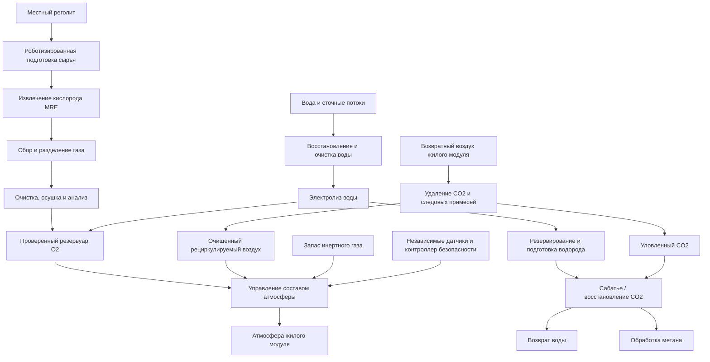

# A-01 AIR-01 — Автономная система атмосферного жизнеобеспечения

**Инженерная концепция v0.1 · 19 ноября 2026 года**  
**Родительская программа:** A-01 LUNA / модульная лунная среда обитания под защитой реголита  
**Статус:** ранняя исследовательская концепция. Не является квалифицированной системой ECLSS, проектом или одобрением NASA, сертифицированной системой поддержания давления, обоснованием безопасности или конкурсной заявкой.

**Языки:** [English](README.md) · [Русский](README_RU.md) · [简体中文](README_ZH.md)

---

## 1. Назначение и замысел

AIR-01 — предлагаемая подсистема атмосферы и жизнеобеспечения A-01 LUNA. Её задача — не просто производить кислород, а помогать поддерживать контролируемую пригодную для дыхания среду внутри жилого модуля, объединяя:

1. производство и накопление кислорода;
2. циркуляцию и очистку воздуха;
3. улавливание и контролируемую переработку углекислого газа;
4. восстановление, очистку воды и электролиз;
5. запас инертного газа и управление составом атмосферы;
6. контроль давления, температуры, влажности, пожара и загрязнений;
7. локальную автономную автоматику, изоляцию отказов и безопасные резервные режимы для экипажа.

Проект разделяет **промышленную переработку местных ресурсов** и **чистую систему жизнеобеспечения жилого модуля**. Неочищенный газ из реактора реголита не должен поступать непосредственно в жилой объём. Его необходимо собрать, подготовить, проанализировать, принять независимыми проверками и только после этого передавать в контролируемый кислородный резервуар.

AIR-01 должна постепенно уменьшать повседневную зависимость от поставок с Земли. При этом концепция не предполагает, что на Луне гарантированно доступны все нужные ресурсы в пригодной форме или что система сможет работать без первоначальных запасов, запасных частей, обслуживания и аварийных резервов.

## 2. Рекомендуемая архитектура

### 2.1. Две физически разделённые зоны

**Зона A — внешняя ресурсная фабрика**
- роботизированный сбор реголита, просеивание и подача сырья;
- высокотемпературный процесс извлечения кислорода; главный кандидат для исследования — электролиз расплава реголита (MRE);
- сбор газов, разделение, очистка, осушка и анализ продукции;
- обработка и хранение металлосодержащих побочных продуктов;
- пылевая изоляция, тепловая защита, сервисный доступ и промышленное электропитание.

**Зона B — чистая установка жизнеобеспечения**
- обработка воды и контроль её питьевого качества;
- электролиз воды и подготовка кислорода;
- резервуары кислорода и инертного газа, регуляторы и интерфейсы смешивания;
- циркуляция воздуха, контроль влажности, удаление следовых загрязнителей и улавливание CO₂;
- установка восстановления CO₂, например реактор Сабатье, если водород и побочные газовые потоки можно безопасно использовать;
- независимые датчики, локальное управление, резервное питание и доступные экипажу сервисные точки.

Между зонами располагается двойной герметичный интерфейс передачи продукта. Он должен не допускать проникновения пыли, горячих технологических газов, паров металлов и непроверенной продукции в жилой модуль.

### 2.2. Поток системы

Это функциональная блок-схема, а не схема трубопроводов и контрольно-измерительных приборов (P&ID). Расположение клапанов, диаметры линий, рабочие давления, устройства сброса, материалы и блокировки требуют детального проектирования.

## 3. Стратегия получения кислорода

AIR-01 следует исследовать два дополняющих друг друга пути, а не полагаться на один процесс.

### 3.1. Основной кандидат из местных ресурсов Луны: электролиз расплава реголита

При MRE электрический ток проходит через расплавленный реголит. Оксиды металлов восстанавливаются, в результате образуются газообразный кислород и металлосплавный продукт.

В записи NASA NTRS о крупномасштабной демонстрации, проведённой в конце 2024 года, указано:
- переработано 25 кг имитатора лунного реголита;
- средняя скорость производства кислорода составила 0,07 кг/ч;
- электрохимический процесс непрерывно поддерживался в течение девяти часов;
- испытание проходило в условиях, имитирующих вакуумную среду.

Это значимая наземная демонстрация, но не подтверждённая круглосуточная производительность, не лунное развёртывание, не сертификация чистоты кислорода и не доказательство автономной долговременной работы. AIR-01 должна предусматривать очистку и проверку газа между реактором и жилым модулем. [NASA NTRS 20260003760](https://ntrs.nasa.gov/citations/20260003760)

NASA также моделировала более крупную установку MRE — от выемки и предварительного нагрева сырья до реактора, очистки кислорода и хранения продуктов. Публичная запись описывает моделирование массы, объёма и мощности для нескольких годовых целей производства, но не приводит в аннотации подтверждённой величины мощности для AIR-01. Поэтому в этой записке электрические и тепловые нагрузки MRE оставлены открытыми: выдумывать значение в кВт было бы неправильно. [NASA NTRS 20240013999](https://ntrs.nasa.gov/citations/20240013999)

### 3.2. Поддерживающий путь: электролиз воды

Электролиз воды уже используется в кислородогенераторе Oxygen Generation Assembly на Международной космической станции. Для него нужна очищенная вода; на выходе образуются кислород и водород:

[
2H_2O 
ightarrow 2H_2 + O_2
]

Описание ECLSS NASA для МКС документирует совместную работу восстановления воды, очистки воздуха, генерации кислорода и установки восстановления CO₂ Сабатье. По данным NASA, система восстановления воды на МКС возвращает и повторно использует около 90% воды станции. Это орбитальный ориентир, а не гарантированный показатель для лунной базы. [NASA ECLSS](https://www.nasa.gov/reference/environmental-control-and-life-support-systems-eclss/)

Для A-01 LUNA вода на первых этапах может доставляться с Земли и повторно использоваться. Лунный лёд — возможный будущий источник сырья только после обследования конкретной площадки, демонстрации добычи, разработки очистки и проверки качества воды.

### 3.3. Неочищенный кислород не поступает в жилой модуль

Внешняя производственная линия должна измерять и контролировать как минимум:
- концентрацию и расход кислорода;
- содержание водяного пара и конденсируемых примесей;
- частицы и загрязнители, возникающие из-за химии процесса;
- давление и температуру;
- другие вещества, определённые химией процесса и испытаниями материалов.

Газ, не соответствующий требованиям, изолируется от линии подачи в жилой модуль. Он направляется на повторную обработку, исследование или удаление через утверждённую систему. Кислород в жилую атмосферу поступает только через отдельно управляемый и контролируемый интерфейс.

## 4. Предварительный массовый баланс для экипажа

Это арифметическая основа для планирования, а не медицинская спецификация экипажа и не окончательная база расчёта системы.

### 4.1. Исходный сценарий

В исследовании NASA по жизнеобеспечению приведены ориентировочные значения около 0,84 кг O₂ на человеко-сутки и около 1,0 кг CO₂ на человеко-сутки. AIR-01 использует их для предварительной модели экипажа из четырёх человек. Фактические нагрузки зависят от активности, физиологии экипажа, профиля миссии, тренировок, выходов в открытый космос и конструкции жилого модуля. [NASA NTRS 20190027610](https://ntrs.nasa.gov/citations/20190027610)

| Показатель | На человека в сутки | Экипаж из четырёх человек |
|---|---:|---:|
| Потребность в кислороде | 0,84 кг | **3,36 кг/сутки** |
| Образование CO₂ | 1,00 кг | **4,00 кг/сутки** |
| Потребность в O₂ за 30 дней | 25,2 кг | **100,8 кг** |
| Потребность в O₂ за 365 дней | 306,6 кг | **1 226,4 кг** |
| Образование CO₂ за 365 дней | 365 кг | **1 460 кг** |

Значения не учитывают кислород для EVA, утечки, потери через шлюз, аварийное использование, остатки в баках, технологические потери, простои обслуживания и запас по требованиям конкретной миссии.

### 4.2. Стехиометрия электролиза воды

На каждый 1 кг кислорода, полученного идеальным электролизом воды:
- требуется 1,125 кг исходной воды;
- образуется 0,125 кг водорода.

Для эталонного экипажа из четырёх человек:

| Идеальный поток | Расчётное значение |
|---|---:|
| Производство O₂ | 3,36 кг/сутки |
| Вода на электролиз | **3,78 кг/сутки** |
| Образование водорода | **0,42 кг/сутки** |

Это только химический массовый баланс. Реальной системе необходимы очистка воды, осушка газов, разделение потоков, учёт утечек, продувки и запас по характеристикам оборудования.

### 4.3. Что может и чего не может замкнуть контур Сабатье

Идеальная реакция Сабатье:

[
CO_2 + 4H_2 
ightarrow CH_4 + 2H_2O
]

Если весь водород в количестве 0,42 кг/сутки из рассматриваемого потока электролиза подать в идеальный реактор Сабатье, стехиометрический верхний предел составит:

| Поток Сабатье | Идеальное количество |
|---|---:|
| Переработка CO₂ | 2,31 кг/сутки |
| Возврат воды | 1,89 кг/сутки |
| Образование метана | 0,84 кг/сутки |
| Остаток от 4,00 кг/сутки метаболического CO₂ | **1,69 кг/сутки** |

Это показывает важное ограничение: водорода, образуемого только при электролизе воды для производства кислорода, недостаточно для переработки всего CO₂ эталонного экипажа реакцией Сабатье. Поэтому A-01 не должна описывать эту конфигурацию как полностью замкнутый кислородный или углеродный цикл.

Необходимо сравнить дополнительные способы восстановления CO₂, контролируемое хранение/удаление, возможную переработку метана и массу, мощность, тепло, риски и обслуживание каждого варианта. NASA описывает работу Сабатье на МКС и образование метана и воды; текущая конфигурация МКС выпускает метан, а не использует его как полностью замкнутый ресурсный поток. [NASA ECLSS](https://www.nasa.gov/reference/environmental-control-and-life-support-systems-eclss/) · [Обзор систем NASA ECLS](https://ntrs.nasa.gov/citations/20210010644)

### 4.4. Сравнение с производительностью MRE

В записи NASA NTRS для демонстрации MRE указана средняя производительность 0,07 кг O₂/ч в течение девятичасового запуска. Простая арифметическая экстраполяция этой скорости на 24 часа даёт 1,68 кг/сутки.

- Эталонная потребность четырёх человек: 3,36 кг/сутки.
- Теоретическая экстраполяция демонстрационной скорости: 1,68 кг/сутки.
- Арифметическое покрытие: 50%.
- Средняя производительность, необходимая для 3,36 кг/сутки за 24 часа: 0,14 кг/ч.

Это **не** утверждение, что испытанный реактор может непрерывно работать, поддерживать постоянный выход или что один либо два реактора безопасно обеспечат требования лунного жилого модуля. Сравнение показывает необходимость масштабирования, моделирования рабочего цикла, учёта деградации, плана обслуживания и независимого резерва.

## 5. Запасы кислорода и атмосферы

Предварительный сценарий запасов позволяет отделить производство от немедленного потребления экипажа.

| Период обеспечения O₂ | Запас для четырёх человек |
|---|---:|
| 24 часа | 3,36 кг |
| 72 часа | **10,08 кг** |
| 7 дней | **23,52 кг** |

Сценарии на 72 часа и 7 дней — планировочные допущения A-01, а не предписанные NASA сроки резервирования. Они отражают только метаболическое пополнение кислорода. В них не включены кислород, уже находящийся в жилой атмосфере, газ в трубопроводах, неиспользуемый остаток в баке, запас регулирования давления, EVA, пожаротушение, утечки, медицинское использование и другие потребители миссии.

Отдельно нужен запас инертного газа. Нельзя считать, что начальная атмосфера состоит из чистого кислорода. Общее давление, парциальное давление кислорода, состав инертного разбавителя, парциальное давление CO₂, влажность, температура и следовые загрязнители должны соответствовать утверждённым требованиям по человеко-машинным системам для конкретной миссии. В этой концепции не следует выдумывать состав смеси: необходимо использовать действующую применимую редакцию NASA-STD-3001 Volume 2 и медицинскую экспертизу. [NASA: требования к атмосфере и внутренней среде, раздел 6](https://www.nasa.gov/reference/6-0-natural-and-induced-environments-vol-2/)

Для хранения следует сравнить:
- сжатый газообразный кислород для буферного запаса жизнеобеспечения;
- криогенный кислород — только если отдельно обосновано применение в качестве топлива или промышленного ресурса;
- независимые регуляторы, отсечные клапаны, обнаружение утечек и сброс давления;
- раздельную физическую прокладку линий кислорода, водорода, метана и инертного газа;
- пожаробезопасные материалы и совместимые процедуры очистки и обслуживания.

Обогащение кислородом повышает пожарную опасность. Нельзя использовать концентрацию кислорода как упрощённую замену контролю давления или комфорта.

## 6. Энергетика и тепловая архитектура

В цитируемых публичных аннотациях нет обоснованной общей величины мощности AIR-01 в кВт или кВт·ч/сутки. Было бы неправильно её выдумывать. Система должна рассчитываться по измеренным данным подсистем и модели конкретной площадки и миссии.

В энергетический баланс необходимо отдельно включить:

| Группа нагрузки | Основные потребители | Текущий статус |
|---|---|---|
| Обработка реголита | выемка, просеивание, подача сырья, предварительный нагрев | Требуются модель и испытания |
| Процесс MRE | высокотемпературный реактор, ток электролиза, теплоизоляция и управление | Требуются модель и испытания |
| Подготовка кислорода | разделение газа, очистка, осушка, анализ, компримирование | Требуются модель и испытания |
| Водный контур | обработка сточных вод, фильтрация, каталитическая очистка, насосы | Есть наследие МКС; параметры Луны открыты |
| Генерация кислорода | электролизёр, разделение газа и управление | Есть наследие МКС; параметры Луны открыты |
| Очистка CO₂ и следовых газов | сорбционные блоки, регенерация, каталитическое окисление, вентиляторы | Есть наследие МКС; параметры Луны открыты |
| Восстановление CO₂ | реактор Сабатье, нагрев катализатора, обработка газа | Есть наследие МКС; параметры Луны открыты |
| Воздушные системы жилого модуля | циркуляция, влажность, терморегулирование, датчики | Зависит от миссии |
| Дополнительная установка LOX | сжижение и криокулер | Не входит в базовое допущение AIR-01 |

Для расчёта используется прослеживаемая модель:

[
P_{total}(t)=sum_i P_i(t)
]

[
E_{day}=int_{0}^{24h} P_{total}(t),dt
]

Для периода темноты конкретной площадки:

[
E_{dark}=rac{int_{dark}P_{critical}(t),dt}{eta_{storage}}+E_{reserve}
]

Промышленная установка MRE должна иметь отдельную высокомощную шину питания, не связанную напрямую с критической шиной жизнеобеспечения. Останов процесса, неисправность нагревателя или заклинивание подачи реголита не должны отключать циркуляцию воздуха в жилом модуле, удаление CO₂, контроль атмосферы или аварийную автоматику.

Периодическая выработка с накоплением кислорода может уменьшить потребность в непрерывной работе высокотемпературной установки. Но такой режим требуется подтвердить с учётом объёма хранения, загрязнения, термоциклов, обслуживания и доступности энергии на Луне.

## 7. Управление, мониторинг и автономность

AIR-01 должна локально работать без постоянной связи с Землёй.

**Постоянно измеряемые параметры**
- общее давление в жилом модуле;
- парциальное давление кислорода;
- парциальное давление или подтверждённый состав инертного газа;
- парциальное давление CO₂;
- влажность и температура;
- следовые загрязнители и частицы;
- расход вентиляции и перепад давления;
- давление, оценка количества и состояние клапанов кислородного резерва;
- качество воды и состояние её запасов;
- состояние шин электропитания и температура промышленного оборудования.

**Разделение управления**
- локальный технологический контроллер для штатной работы;
- независимый контроллер безопасности для обнаружения отказов, изоляции и защитных действий;
- резервные или разнородные датчики для критических параметров;
- ручное управление экипажем и понятная изоляция оборудования для обслуживания;
- локальный журнал событий и доступные процедуры при потере связи.

Поддержка Евы или Земли может помогать анализу и планированию обслуживания, но основные функции управления атмосферой и аварийного реагирования должны оставаться локальными и не зависеть от ИИ-сервиса или удалённого оператора.

## 8. Предварительная карта отказов

| Отказ | Возможное последствие | Обнаружение | Необходимая реакция системы |
|---|---|---|---|
| Остановка MRE или отсутствие подачи сырья | Снижение местного производства O₂ | Состояние реактора, тренд газового потока, запас продукции | Изолировать промышленную установку; использовать проверенный резерв O₂; ремонтировать без остановки ECLSS жилого модуля |
| Кислород MRE не соответствует требованиям | Перенос загрязнений в жилой объём | Независимый анализ газа и проверка качества | Закрыть линию передачи; направить газ на повторную очистку/изолированное хранение; не обходить контроль качества |
| Нарушение качества воды | Загрязнение электролизёра или воды экипажа | Контроль проводимости и установленных требований чистоты | Изолировать партию; повторно обработать или использовать проверенный запас воды |
| Прорыв CO₂ через очиститель | Рост концентрации CO₂ в жилом модуле | Независимые датчики CO₂ и состояние сорбента | Переключить независимый резервный блок; снизить нагрузку и выполнить аварийные процедуры экипажа |
| Утечка давления | Потеря запаса атмосферы | Тренд давления и датчики по зонам | Изолировать повреждённую зону, использовать запас, выполнять утверждённую процедуру потери давления |
| Отказ датчика O₂ или инертного газа | Ошибочное управление атмосферой | Сверка разнородных датчиков и контроль правдоподобия | Перейти в консервативный режим; использовать независимое измерение и подтверждение экипажем |
| Потеря основного питания | Остановка активного оборудования жизнеобеспечения | Мониторинг шин и состояния батарей | Сохранить критическую шину; первыми отключать промышленные нагрузки; использовать резерв питания и процедуры экипажа |
| Отказ вентилятора циркуляции | Локальные зоны повышенного CO₂/влажности | Датчики расхода и распределённые датчики атмосферы | Переключить резервную линию циркуляции; изолировать неисправный блок |
| Пожар или обогащение кислородом | Быстрое усиление пожарной опасности | Системы обнаружения огня/дыма и датчики атмосферы | Изолировать подачу кислорода в затронутую зону, включить утверждённую независимую систему пожарного реагирования |
| Утечка метана или водорода | Воспламеняемость и опасность для оборудования | Специальные газовые датчики и контроль давления | Изолировать технологический газ; продувку/сброс выполнять только по утверждённому безопасному маршруту |
| Проникновение реголитовой пыли | Абразивный износ, загрязнение и нагрузка на фильтры | Перепад давления, датчики частиц и диагностика оборудования | Изолировать промышленную границу, очистить/заменить фильтры, проверить уплотнения |
| Потеря связи с Землёй | Отсутствие удалённой поддержки | Мониторинг состояния канала | Продолжать локальное управление и использовать сохранённые процедуры; не зависеть от постоянной связи |

Это начальный список опасностей, а не полный анализ рисков и не доказательство отказоустойчивости. Для каждой строки позднее нужно определить тяжесть, вероятность, обнаруживаемость, доказательства проверки и ответственного владельца риска.

## 9. Этапы разработки и проверки

**AIR-01A — учёт газов и требования**
- зафиксировать численность экипажа, профиль активности, концепцию давления и длительность миссии;
- определить источники и потоки O₂, CO₂, инертного газа, воды и загрязнителей;
- выбрать требования к атмосфере по применимым стандартам человеко-машинных систем.

**AIR-01B — стенд чистой воды и электролиза**
- продемонстрировать контроль качества и изоляцию воды;
- измерить производство кислорода и водорода, чистоту и побочные потоки;
- независимо проверить подготовку газа без подключения к жилому модулю.

**AIR-01C — улавливание и восстановление CO₂**
- измерить ёмкость улавливания CO₂, проскок, регенерацию и энергопотребление;
- сравнить Сабатье с альтернативными вариантами восстановления CO₂;
- замкнуть массовые балансы воды, водорода, метана, углерода и кислорода.

**AIR-01D — демонстратор интерфейса MRE**
- определить герметичную границу сбора газа вокруг репрезентативного реактора MRE;
- измерить производительность, примеси, термоциклы, энергию, подачу сырья и потребности в обслуживании;
- продемонстрировать автоматическую изоляцию продукта, не соответствующего требованиям.

**AIR-01E — интегрированный контур жилого модуля**
- объединить мониторинг атмосферы, циркуляцию, водоподготовку, резерв O₂, удаление CO₂ и независимую автоматику безопасности;
- провести испытания с искусственным внесением отказов и длительные тесты замкнутого цикла;
- проверить режимы потери питания и связи.

Этап нельзя помечать как «испытан», пока не опубликованы измеренные данные и условия теста. Подсистему нельзя помечать как «квалифицированную» без соответствующей программы квалификации и утверждения.

## 10. Открытые инженерные вопросы

1. Какое давление и состав атмосферы нужны для выбранной миссии?
2. Какой инертный газ используется, откуда он поступает и какой запас требуется доставить изначально?
3. MRE предназначен только для кислорода жизнеобеспечения или совместно с производством окислителя для топлива?
4. Какие примеси кислорода ожидаются при выбранном составе реголита и материалах реактора?
5. Какой процесс восстановления CO₂ будет обрабатывать часть CO₂, для которой не хватает водорода?
6. Метан — это запасаемый побочный продукт, сырьё для другой установки или утверждённый поток отходов?
7. Какие данные разведки льда необходимы, прежде чем добыча воды станет базовым сценарием?
8. Каковы бюджеты массы, мощности, тепла, обслуживания и запасных частей?
9. Какая длительность резерва оправдана логистикой и анализом опасностей миссии?
10. Какие испытания докажут безопасную передачу газа из промышленной установки в жилой модуль?

## 11. Источники NASA

- [NASA — Environmental Control and Life Support Systems (ECLSS)](https://www.nasa.gov/reference/environmental-control-and-life-support-systems-eclss/) — восстановление воды, очистка воздуха, генерация кислорода и интеграция Сабатье на МКС.
- [NASA NTRS 20260003760 — крупномасштабная демонстрация MRE](https://ntrs.nasa.gov/citations/20260003760) — 25 кг имитатора реголита, средняя производительность 0,07 кг O₂/ч, девятичасовой запуск в вакуумных условиях.
- [NASA NTRS 20240013999 — моделирование лунной установки MRE](https://ntrs.nasa.gov/citations/20240013999) — моделирование добычи, предварительного нагрева, MRE, очистки кислорода, обращения с продуктами, массы/объёма/мощности установки.
- [NASA NTRS 20190027610 — проектирование жизнеобеспечения лунной базы](https://ntrs.nasa.gov/citations/20190027610) — планировочная база и компромиссы логистики жизнеобеспечения.
- [NASA OCHMO-TB-004 — углекислый газ](https://www.nasa.gov/ochmo-tb-004-carbon-dioxide-2/) — влияние CO₂ на здоровье и ограничения для жилой среды.
- [NASA: требования к атмосфере и внутренней среде, Volume 2, раздел 6](https://www.nasa.gov/reference/6-0-natural-and-induced-environments-vol-2/) — применимые требования к атмосфере и внутренней среде.

## 12. Статус и ограничения

**AIR-01 v0.1 — концепция и предварительный массовый баланс в текстовом виде.** Нет подтверждённых значений массы системы, мощности, размеров резервуаров, конструкции сосудов под давлением, тепловой модели, медицинского допуска экипажа, квалификации жизнеобеспечения или результатов лунных испытаний.

Расчёты основаны на идеальной стехиометрии и приблизительных нагрузках экипажа. Они не учитывают КПД реального оборудования, утечки, простои обслуживания, примеси процесса, ограничения хранения и запасы для конкретной миссии. Оборудование NASA для МКС подтверждает работу отдельных функций, но не доказывает, что его можно без переработки развернуть на Луне.

Перед реальным внедрением или любыми заявлениями о безопасности проект должны проверить профильные специалисты по жизнеобеспечению, химическим процессам, системам давления, пожарной безопасности, теплу, энергетике, человеческому фактору и эксплуатации миссии.

---

*Этот документ — независимая исследовательская концепция A-01. Он не является документом NASA, одобрением NASA, сертифицированным проектом жизнеобеспечения или официальной конкурсной заявкой.*
