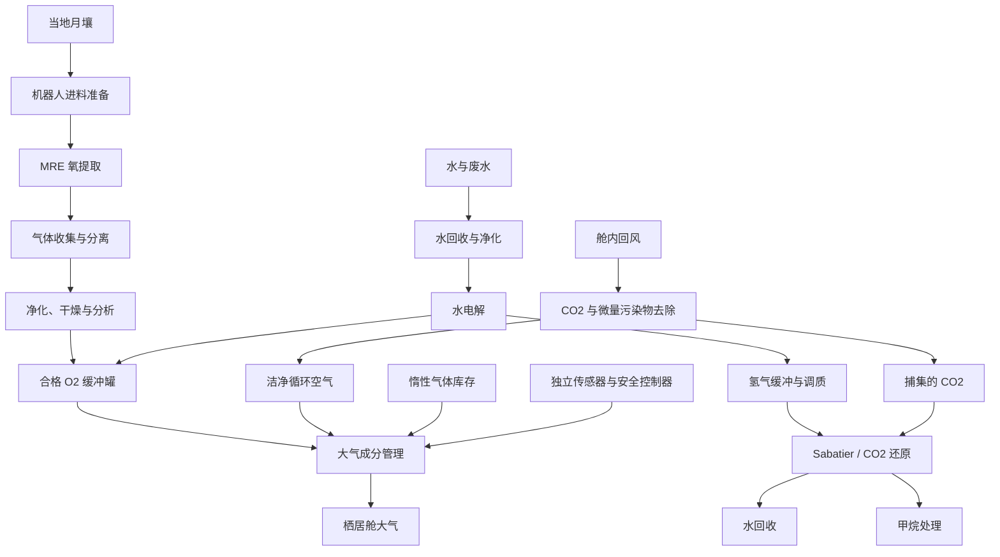

# A-01 AIR-01 — 自主式栖居舱大气与生命保障基础设施

**工程概念说明 v0.1 · 2026年11月19日**  
**上级项目：** A-01 LUNA / 月壤防护模块化栖居舱  
**状态：** 早期研究概念。不是经过飞行鉴定的 ECLSS、NASA 设计或背书、经认证的压力系统、安全论证或竞赛提交材料。

**语言：** [English](README.md) · [Русский](README_RU.md) · [简体中文](README_ZH.md)

---

## 1. 任务与设计意图

AIR-01 是为 A-01 LUNA 提出的栖居舱大气与生命保障子系统。它的目标不只是制造氧气，而是通过协调以下系统，帮助维持可控、可呼吸的栖居环境：

1. 氧气生产与储存；
2. 舱内空气循环和净化；
3. 二氧化碳捕集与受控处理；
4. 水回收、净化和电解；
5. 惰性气体库存与大气成分控制；
6. 压力、温度、湿度、火灾和污染物监测；
7. 本地自主控制、故障隔离和乘员安全备用模式。

设计将**工业资源处理区**与**洁净生命保障区**分开。月壤反应器产生的原始气体不得直接进入有人居住的舱体。气体必须先被收集、调质、分析并通过独立检查，之后才能转入受控氧气缓冲储罐。

AIR-01 的长期目标是逐步减少日常地球补给依赖。但本概念不假设月球上所有必需资源都以可用形式存在，也不假设系统可以在没有初始库存、备件、维护和应急储备的情况下运行。

## 2. 建议架构

### 2.1 两个物理隔离区域

**A 区 — 外部资源工厂**
- 机器人收集月壤、筛分和进料处理；
- 高温氧提取工艺，首选研究候选方案为熔融月壤电解（MRE）；
- 气体收集、分离、净化、干燥和产品分析；
- 含金属副产物的处理与储存；
- 防尘隔离、热防护、维护通道和工业供电。

**B 区 — 洁净生命保障设备间**
- 水处理与饮用水质量监测；
- 水电解和氧气调质；
- 氧气与惰性气体缓冲储罐、调压器和混合接口；
- 舱内空气循环、湿度控制、微量污染物去除和 CO₂ 捕集；
- CO₂ 还原设备，例如 Sabatier 反应器（前提是氢气和副产物流能够安全管理）；
- 独立传感器、本地控制、备用电源和乘员可维护接口。

双重边界的传输接口用于隔开两个区域，防止月尘、高温工艺气体、金属蒸气和未经验证的产物进入有人居住的舱体。

### 2.2 系统流程

这是一张功能框图，不是管道仪表流程图（P&ID）。阀门位置、管线尺寸、工作压力、泄压装置、材料和联锁仍需详细工程设计。

## 3. 氧气供应策略

AIR-01 应研究两条互补的氧气路径，而不是依赖单一工艺。

### 3.1 月球本地资源候选主路径：熔融月壤电解

MRE 通过电流使月壤熔融，并还原其中的金属氧化物，生成氧气和金属合金产物流。

NASA NTRS 关于 2024 年末大型演示的记录报告：
- 处理了 25 kg 月壤模拟物；
- 平均氧气产率为 0.07 kg/h；
- 电化学处理持续了 9 小时；
- 在相关真空环境条件下运行。

这是重要的地面演示，但并不代表已证明可连续 24 小时生产、已在月球部署、氧气纯度已获认证，或已能自主长期运行。AIR-01 必须在反应器与栖居舱之间设置气体净化和验证环节。[NASA NTRS 20260003760](https://ntrs.nasa.gov/citations/20260003760)

NASA 还对更大型的 MRE 工厂进行了系统建模，范围从月壤挖掘和预热，到反应器、氧气净化和产品储存。公开记录说明研究进行了质量、体积和功率建模，并考虑了若干年产量目标，但摘要没有提供可直接用于 AIR-01 的已验证功率值。因此，本说明将 MRE 电力和热负荷列为待研究项，不虚构 kW 数值。[NASA NTRS 20240013999](https://ntrs.nasa.gov/citations/20240013999)

### 3.2 辅助路径：水电解

水电解已经用于国际空间站的 Oxygen Generation Assembly。该过程需要经过净化的进水，并产生氧气和氢气：

[
2H_2O 
ightarrow 2H_2 + O_2
]

NASA 对国际空间站 ECLSS 的说明记录了水回收、空气净化、氧气生成和 Sabatier CO₂ 还原设备之间的集成。NASA 报告称，空间站水回收系统可回收并循环利用约 90% 的站内用水；这是轨道空间站的参考指标，并不保证月球基地可以达到相同性能。[NASA ECLSS](https://www.nasa.gov/reference/environmental-control-and-life-support-systems-eclss/)

对 A-01 LUNA 来说，初期水可能由地球运送并循环利用。月球冰只有在完成场地资源调查、采矿演示、净化工艺和水质验证后，才可作为未来的供水来源。

### 3.3 未净化氧气不得直接进入栖居舱

外部生产线至少应测量和控制：
- 氧气浓度与流量；
- 水蒸气及可凝结物含量；
- 颗粒物和工艺产生的污染物；
- 压力和温度；
- 根据工艺化学和材料测试确定的其他物质。

不符合要求的气体必须与栖居舱供气管路隔离，留待重新处理、调查或通过获批系统处置。只有通过独立控制和监测接口的氧气才能进入栖居舱大气。

## 4. 初步乘员质量平衡

本节是用于规划的算术基准，不是乘员医学规范，也不是最终系统尺寸设计依据。

### 4.1 参考情景

NASA 的一项生命保障研究给出了约 0.84 kg O₂/人·日和约 1.0 kg CO₂/人·日的规划值。AIR-01 采用这些数值建立四人乘员参考情景。实际负荷会受到活动量、乘员生理状况、任务剖面、锻炼、舱外活动和栖居舱设计影响。[NASA NTRS 20190027610](https://ntrs.nasa.gov/citations/20190027610)

| 指标 | 每人每天 | 四人参考值 |
|---|---:|---:|
| 氧气需求 | 0.84 kg | **3.36 kg/天** |
| CO₂ 生成量 | 1.00 kg | **4.00 kg/天** |
| 30 天 O₂ 需求 | 25.2 kg | **100.8 kg** |
| 365 天 O₂ 需求 | 306.6 kg | **1,226.4 kg** |
| 365 天 CO₂ 生成量 | 365 kg | **1,460 kg** |

以上数值不包括 EVA 氧气、泄漏、气闸损失、应急用气、储罐残余、工艺损失、维护停机和具体任务的安全裕度。

### 4.2 水电解的化学计量

理想水电解每生产 1 kg 氧气：
- 需要 1.125 kg 水；
- 生成 0.125 kg 氢气副产物。

对于四人参考情景：

| 理想流量 | 推导数值 |
|---|---:|
| O₂ 产量 | 3.36 kg/天 |
| 进入电解的水 | **3.78 kg/天** |
| 产生的氢气 | **0.42 kg/天** |

这只是化学质量平衡。真实系统还需要水净化、气体干燥、分离、泄漏裕度、吹扫流量和设备性能裕度。

### 4.3 Sabatier 循环能够和不能够闭合的部分

理想 Sabatier 反应为：

[
CO_2 + 4H_2 
ightarrow CH_4 + 2H_2O
]

若将参考水电解过程产生的全部 0.42 kg/天氢气输入理想 Sabatier 反应器，按化学计量得到的上限为：

| Sabatier 流量 | 理想数量 |
|---|---:|
| 处理的 CO₂ | 2.31 kg/天 |
| 返回的水 | 1.89 kg/天 |
| 生成的甲烷 | 0.84 kg/天 |
| 从 4.00 kg/天代谢 CO₂ 中剩余的 CO₂ | **1.69 kg/天** |

这揭示了一个重要限制：仅依靠氧气生成电解水所产生的氢气，不足以通过 Sabatier 反应处理参考乘员的全部 CO₂。A-01 不应把这种配置描述为完全闭合的氧气或碳循环。

设计必须比较其他 CO₂ 还原路径、受控储存/排放、甲烷进一步处理，以及各方案的质量、功率、热量、安全和维护成本。NASA 介绍了国际空间站 Sabatier 系统及其甲烷和水副产物；当前 ISS 配置会释放甲烷，并未将其作为完全闭环资源流使用。[NASA ECLSS](https://www.nasa.gov/reference/environmental-control-and-life-support-systems-eclss/) · [NASA ECLS 系统综述](https://ntrs.nasa.gov/citations/20210010644)

### 4.4 与 MRE 产率的比较

NASA NTRS 的 MRE 演示记录了 9 小时运行期间平均 0.07 kg O₂/h 的产率。如果简单地假设该平均速率持续 24 小时，算术外推结果为 1.68 kg/天。

- 四人参考需求：3.36 kg/天。
- 演示速率的 24 小时外推：1.68 kg/天。
- 算术覆盖率：50%。
- 24 小时内达到 3.36 kg/天所需的平均产率：0.14 kg/h。

这**并不**表示被演示的反应器可以连续运行、持续保持恒定产率，也不表示一台或两台反应器能够安全满足月球栖居舱需求。该比较说明需要进行规模扩大研究、运行周期建模、性能衰减裕度、维护策略和独立备用供应设计。

## 5. 氧气与大气储备

初步库存情景有助于将氧气生产与乘员即时需求分开。

| O₂ 供应时长 | 四人参考库存 |
|---|---:|
| 24 小时 | 3.36 kg |
| 72 小时 | **10.08 kg** |
| 7 天 | **23.52 kg** |

72 小时和 7 天是 A-01 的规划情景，不是 NASA 规定的储备时长。它们仅表示代谢耗氧补充量，不包括舱内现有氧气、管线气体、储罐残余、压力控制裕度、EVA、消防、泄漏、医疗使用和任务的其他消耗。

还必须单独管理惰性气体库存。不能假设初始栖居舱大气由纯氧组成。总压力、氧分压、惰性稀释气体成分、CO₂ 分压、湿度、温度和微量污染物必须符合经批准的任务级人因系统要求。本概念不自行指定大气混合比例，应采用适用的现行 NASA-STD-3001 Volume 2 并经过医学审查。[NASA：大气与内部环境要求，第 6 节](https://www.nasa.gov/reference/6-0-natural-and-induced-environments-vol-2/)

储存技术的权衡研究：
- 用于生命保障缓冲库存的压缩气态氧；
- 只有在另有充分依据的推进剂或工业用途时，才考虑低温液氧；
- 独立调压器、隔离阀、泄漏检测和泄压装置；
- 氧气、氢气、甲烷和惰性气体采用物理分离的管线；
- 采用防火材料和兼容的清洁/维护程序。

富氧会提高火灾风险。不能把提高氧浓度当作压力控制或舒适度调节的替代手段。

## 6. 电力与热控架构

引用的公开摘要中没有可用于 AIR-01 的可靠总功率 kW 或每日能耗 kWh 数值。虚构一个数值会产生误导。系统应使用已测量的子系统数据和针对月球场地/任务的模型来确定尺寸。

电力预算应分别考虑：

| 负载组 | 主要设备 | 当前状态 |
|---|---|---|
| 月壤处理 | 挖掘、筛分、进料运输、预热 | 待建模/测试 |
| MRE 工艺 | 高温反应器、电解电流、隔热和控制 | 待建模/测试 |
| 氧气调质 | 气体分离、净化、干燥、分析、压缩 | 待建模/测试 |
| 水循环 | 废水处理、过滤、催化处理、泵 | 有 ISS 技术基础；月球尺寸待定 |
| 氧气生成 | 电解槽、气体分离和控制 | 有 ISS 技术基础；月球尺寸待定 |
| CO₂ 与微量气体处理 | 吸附床、再生、催化氧化、风机 | 有 ISS 技术基础；月球尺寸待定 |
| CO₂ 还原 | Sabatier 反应器、催化剂加热、气体处理 | 有 ISS 技术基础；月球尺寸待定 |
| 栖居舱空气服务 | 空气循环、湿度控制、热控、传感器 | 取决于任务 |
| 可选 LOX 装置 | 液化与低温制冷机 | 不纳入 AIR-01 基线假设 |

使用可追溯的模型：

[
P_{total}(t)=sum_i P_i(t)
]

[
E_{day}=int_{0}^{24h} P_{total}(t),dt
]

针对具体场地的黑暗时段：

[
E_{dark}=rac{int_{dark}P_{critical}(t),dt}{eta_{storage}}+E_{reserve}
]

工业 MRE 工厂必须使用与栖居舱生命保障关键电源总线分开的高功率总线。工艺跳闸、加热器故障或月壤进料卡滞不得导致舱内空气循环、CO₂ 去除、大气监测或应急控制停机。

通过缓冲氧气进行批次生产，可能减少高温工厂连续运行的需求；但必须根据储存能力、污染风险、热循环、维护和月面电力可用性验证这一运行策略。

## 7. 控制、监测与自主运行

AIR-01 应能够在没有持续地球通信的情况下本地运行。

**连续测量变量**
- 栖居舱总压力；
- 氧分压；
- 惰性气体分压或经验证的成分；
- CO₂ 分压；
- 湿度和温度；
- 微量污染物和颗粒物；
- 通风流量和压差；
- 氧气缓冲罐压力、估算库存量和阀门状态；
- 水质和储水状态；
- 电源总线状态及工业设备热状态。

**控制分层**
- 用于正常运行的本地过程控制器；
- 用于检测、隔离和保护动作的独立安全控制器；
- 对安全关键变量使用冗余或不同原理的传感器；
- 乘员手动控制和明确的维护隔离方式；
- 通信中断时仍可访问的本地事件日志和程序。

EVA 或地球端支持可以协助分析和维护规划，但大气的基本控制及应急响应必须保留在本地，不能依赖 AI 服务或远程操作员。

## 8. 初步故障模式图

| 故障 | 潜在后果 | 检测方式 | 必要的系统响应 |
|---|---|---|---|
| MRE 停机或无进料 | 本地氧气产量下降 | 反应器状态、气流趋势、产品库存 | 隔离工业工厂；使用合格 O₂ 库存；维修时不打断栖居舱 ECLSS |
| MRE 氧气不合格 | 污染物进入有人居住空间 | 独立气体分析和质量验收 | 关闭传输通道；转入再处理/隔离储存；禁止绕过质量门槛 |
| 水质不合格 | 污染电解槽或乘员用水 | 电导率和任务规定的纯度监测 | 隔离该批次；重新处理或使用已验证的储水 |
| CO₂ 去除突破 | 舱内 CO₂ 升高 | 独立 CO₂ 传感器和吸附床状态监测 | 切换到独立备用能力；降低负荷并执行乘员应急程序 |
| 舱体压力泄漏 | 大气库存损失 | 压力趋势和分区传感器 | 隔离受影响区域，使用储备库存，执行批准的压力损失响应 |
| O₂ 或惰性气体传感器故障 | 大气控制错误 | 不同原理传感器交叉检查和合理性校验 | 进入保守控制模式；使用独立测量并由乘员核验 |
| 主电源故障 | 主动式生命保障设备停机 | 电源总线与电池状态监控 | 保持关键电源总线；优先削减工业负载；使用备用电源和乘员程序 |
| 空气循环风机故障 | 局部 CO₂/湿度积聚 | 流量和分布式大气传感器 | 切换备用循环通道；隔离故障单元 |
| 火灾或氧气富集事件 | 火灾风险迅速扩大 | 火灾/烟雾探测和大气传感器 | 隔离受影响区域的氧气供应，启动获批的独立消防响应 |
| 甲烷或氢气泄漏 | 可燃性和设备风险 | 专用气体探测和压力监测 | 隔离工艺气体；仅通过批准的安全路径进行吹扫/排放 |
| 月壤粉尘进入 | 磨蚀、污染和过滤器负荷 | 压差、颗粒物和设备诊断 | 隔离工业边界，清洁/更换过滤器并检查密封 |
| 与地球失去通信 | 失去远程支持 | 通信链路监控 | 继续本地闭环控制并调用本地程序；不依赖持续通信 |

这只是初步危险清单，并非完整危险分析或故障容错设计。后续风险登记册应为每一项增加严重度、发生概率、可探测性、验证证据和风险责任人。

## 9. 构建与验证路线图

**AIR-01A — 气体核算与需求**
- 确定乘员人数、活动剖面、栖居舱压力概念和任务时长；
- 建立 O₂、CO₂、惰性气体、水和污染物的来源项与流量；
- 根据适用的人因系统标准选择大气要求。

**AIR-01B — 洁净水和电解台架**
- 演示水质监测与隔离；
- 测量氧气和氢气产率、纯度及副产物流；
- 在不连接栖居舱的情况下独立验证气体调质通道。

**AIR-01C — CO₂ 捕集与还原**
- 测量 CO₂ 捕集容量、穿透、再生和能耗；
- 比较 Sabatier 与其他 CO₂ 还原方案；
- 闭合水、氢气、甲烷、碳和氧的质量平衡。

**AIR-01D — MRE 接口验证样机**
- 定义代表性 MRE 反应器周围密封的气体收集边界；
- 测量产率、杂质、热循环、功率、进料速率和维护需求；
- 演示不合格产物的自动隔离。

**AIR-01E — 集成栖居舱循环**
- 集成大气监测、空气循环、水处理、O₂ 缓冲、CO₂ 去除和独立安全控制；
- 进行故障注入测试和长期闭环测试；
- 验证断电和通信中断模式。

只有在发布了测量数据和测试条件后，才能将阶段标为“已测试”。没有相应的鉴定程序和批准，不得将子系统标为“已鉴定合格”。

## 10. 待解决的工程问题

1. 所选任务需要什么栖居舱压力和大气成分？
2. 使用哪一种惰性气体、来源是什么、初期需要运送多少？
3. MRE 仅用于生命保障氧气，还是与推进剂生产共享？
4. 所选月壤成分和反应器材料会产生哪些氧气杂质？
5. 哪种 CO₂ 还原工艺用于处理现有氢气无法处理的那部分 CO₂？
6. 甲烷是储存的副产物、其他工艺的原料，还是获批的废物流？
7. 在将水冰开采纳入基线之前，需要什么资源勘探证据？
8. 质量、功率、热量、维护和备件预算是多少？
9. 任务物流和危险分析支持多长的储备时长？
10. 哪些测试可以证明工业工厂向有人居住的栖居舱安全输送气体？

## 11. NASA 参考资料

- [NASA — Environmental Control and Life Support Systems (ECLSS)](https://www.nasa.gov/reference/environmental-control-and-life-support-systems-eclss/) — 国际空间站水回收、空气净化、氧气生成和 Sabatier 集成。
- [NASA NTRS 20260003760 — 熔融月壤电解大型演示](https://ntrs.nasa.gov/citations/20260003760) — 25 kg 月壤模拟物、平均 O₂ 产率 0.07 kg/h、真空条件下持续 9 小时。
- [NASA NTRS 20240013999 — 月球 MRE 工厂系统建模](https://ntrs.nasa.gov/citations/20240013999) — 挖掘、预热、MRE、氧气净化、产品处理以及工厂质量/体积/功率分析。
- [NASA NTRS 20190027610 — 月球基地生命保障设计](https://ntrs.nasa.gov/citations/20190027610) — 规划依据和生命保障物流权衡。
- [NASA OCHMO-TB-004 — 二氧化碳](https://www.nasa.gov/ochmo-tb-004-carbon-dioxide-2/) — CO₂ 对健康的影响及栖居环境限制。
- [NASA：大气与内部环境要求，Volume 2，第 6 节](https://www.nasa.gov/reference/6-0-natural-and-induced-environments-vol-2/) — 适用的大气和舱内环境要求。

## 12. 状态与限制

**AIR-01 v0.1 是一个概念和初步质量平衡说明。** 尚无经验证的系统质量、功率、储罐尺寸、压力容器设计、热模型、乘员医学批准、生命保障鉴定或月球测试记录。

参考计算采用理想化学计量和近似乘员负荷。它们没有计入实际设备效率、泄漏、维护停机、工艺杂质、储存限制和任务专用裕度。NASA 国际空间站设备可以证明部分组件功能，但不能证明相同系统无需重新设计就能在月球部署。

在实际实施或提出任何安全声明之前，本项目必须由生命保障、化学工艺、压力系统、消防安全、热控、电力、人因和任务运行领域的合格专家审查。

---

*本文是 A-01 的独立研究概念。它不是 NASA 文件、NASA 背书、经认证的生命保障设计或官方竞赛提交材料。*
